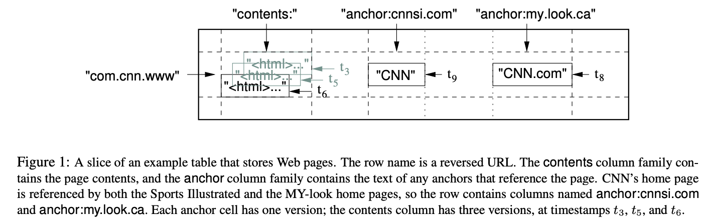

import jd1 from './jd1.png';

## 제프 딘 가라사대, "분산데이터저장소 있으라" 하시매..

[Bigtable](https://static.googleusercontent.com/media/research.google.com/ko//archive/bigtable-osdi06.pdf) 은 2006년에 구글에서 공개한 분산 데이터 저장소이다. Bigtable 은 구글의 여러 서비스에서 사용되고 있으며, 그 중에서도 구글 검색 엔진과 구글 맵스에서 사용되고 있다.
[현재는 구글 클라우드를 통해 서비스 되고 있는 것을 확인할 수 있다.](https://cloud.google.com/bigtable?hl=ko)

Bigtable 공개로 부터 15년이 훌쩍 넘은 지금은 분산 시스템을 다루는 모던한 기술들이 많이 있지만, 2006년 당시에는 대단한 기술이었고, 현재의 구글의 핵심 서비스들의 기반이 되는 기술이다.

__그럼 이 Bigtable 은 누가 만들었을까?__

<p style={{ textAlign: 'center' }}>
  
  <em>출처: <a href="https://ttimes.co.kr/article/2023050418237753322/">ttimes</a></em>
</p>

chatgpt 는 물론 stack overflow, 구글링 같은 웹에서 양질의 정보를 찾기 힘든 시절에 이러한 시스템을 만든 사람은, 아직까지도 구글에서 단 2명 뿐인 L11 개발자인 **제프 딘(Jeff Dean)** 이다.

([하지만 제프딘 형님은 인터뷰에서 엔지니어로 살아오면서 저질렀던 가장 큰 실수라고 한다..](https://dev-ahn.tistory.com/136))

## 근데 왜 15년이나된 고대 기술을 알아야하는가?

[Pirius](https://github.com/paust-team/pirius) 프로젝트를 진행하면서 분산 환경에서의 storage를 구현하는데 핵심이 되는 RocksDB 를 이해하기 전에, LevelDB 와 Bigtable 에 대해 이해가 필요하다고 판단을 했다.

우선 Bigtable은 분산 NoSQL 데이터베이스로, 내부적으로 **LSM(Log-Structured Merge) 트리 기반의 SSTable 구조** 를 사용한다.
BigTable 논문이 공개된 뒤, 같은 아이디어를 바탕으로 단일 노드용 LSM 엔진인 LevelDB 가 공개되었고, 이후에 페이스북이 **LevelDB** 를 Fork 하여 Performance, Concurrency, Configuration 등을 확장한 버전인 **RocksDB** 를 만들었다.

Bigtable 기술 자체는 15년전에 나온 아이디어지만, 내부에서 Bigtable을 기반으로 다양한 서비스가 운영되면서 계속 개량과 확장을 거쳤고, 그 기술을 클라우드 서비스 형태로 재구성해 외부에 제공한 것이 Google Cloud Bigtable 이다.
따라서 내가 분석할 Bigtable 은 2006년 당시의 논문이므로, 현재 GoogleCloud 의 Bigtable 구조와 기능적인 부분에서 차이가 있을 수 있다.

## "A Distributed Storage System for Structured Data"

Bigtable 은 논문의 제목 그대로 **Structured Data** 를 위한 분산 저장소이다.

- **Structured Data**: 정형화된 데이터로, Strict Schema 를 준수하는 데이터 (행과 열로 구성)
- **Unstructured Data**: 비정형화된 데이터 (이미지, 비디오, 오디오 등)
- **Semi-Structured Data**: 반정형화된 데이터 (XML, JSON, YAML 등)

논문의 abstract 에 나와있는 내용을 보면, Bigtable 은 다음과 같은 목적을 가지고 있다.

1. **대규모 데이터 관리를 위한 분산 스토리지 제공** — 페타바이트급 데이터와 수천 대 규모의 저비용 서버를 활용
2. **다양한 구글 서비스에서의 공통 스토리지 요구 사항 충족** — 구글 검색, 구글 어스, 구글 파이낸스 등
3. **단순한 데이터 모델과 동적 제어** — 클라이언트가 데이터 구조와 포맷을 동적으로 제어
4. **유연성과 고성능을 동시에 제공** — 높은 처리량과 빠른 응답 속도

## Bigtable 의 데이터 모델

> A Bigtable is a sparse, distributed, persistent multidimensional **sorted map**. The map is **indexed by a row key, column key, and a timestamp**; each value in the map is an **uninterpreted array of bytes**. (row:string, column:string, time:int64) → string

Bigtable 은 **multi-dimensional sorted map** 이다.
1. Row key, Column key, Timestamp 라는 **세 차원(multi-dimensional)** 으로 구성된,
2. Row key를 기준으로 전체 데이터가 사전순(lexicographical) **정렬(sorted)** 된,
3. **key-value 쌍(map)**

논문에서 figure1 으로 설명하고 있는 Webtable 예제:



이를 JSON 구조로 표현하면:
```json
{
  "com.cnn.www": {
    "anchor": {
      "cnnsi.com": { "t9": "CNN" },
      "my.look.ca": { "t8": "CNN.com" }
    },
    "contents": {
      "t3": "<html>...</html>",
      "t5": "<html>...</html>",
      "t6": "<html>...</html>"
    }
  }
}
```

Bigtable 에 저장되는 데이터는 `array[rowkey][columnkey][timestamp]` 형태로 접근할 수 있다.

### Rows

- **Row Key 의 특성**: 임의의 문자열 사용 가능 (최대 64KB), 동일 Row Key에 대한 읽기/쓰기는 **Atomic**
- **Lexicographic 정렬 및 동적 분할**: Row Key 기준 사전순 정렬, **Tablet** 단위로 분산 및 부하 분산
- **Locality를 고려한 RowKey 설계**: 자주 함께 조회되는 데이터가 인접하도록 저장 (예: 도메인 역순 `com.google.maps/index.html`)

### Column Family

- **Column Family**: 여러 열(Column)들을 하나의 그룹으로 묶은 것. Bigtable 에서의 기본 접근 제어 단위
- **데이터 일관성**: 같은 유형의 데이터를 함께 압축 → 높은 압축률
- **제약 조건**: 테이블 내 Column Family 는 수백 개 정도로 제한, 운영 중에는 잘 변하지 않는 것이 이상적
- Column key(Qualifier)는 **무제한**으로 생성 가능

### Timestamps

- 각 셀은 동일 데이터의 **여러 버전**을 저장 가능, Timestamp 에 의해 구분 (64비트 정수)
- **자동할당**: Bigtable이 ms 단위로 실제 시간을 기록
- **수동할당**: 사용자가 직접 timestamp 지정
- **Garbage Collection**: 최대 n개 버전만 유지하거나, 유효 기간이 지난 데이터 자동 삭제 가능

---

여기까지, Bigtable 의 개요와 데이터 모델에 대해 정리해보았다. 다음 Part 에서는 Bigtable 을 이루는 Building Block 들과 주요 implementation 에 대해 살펴보겠다.
