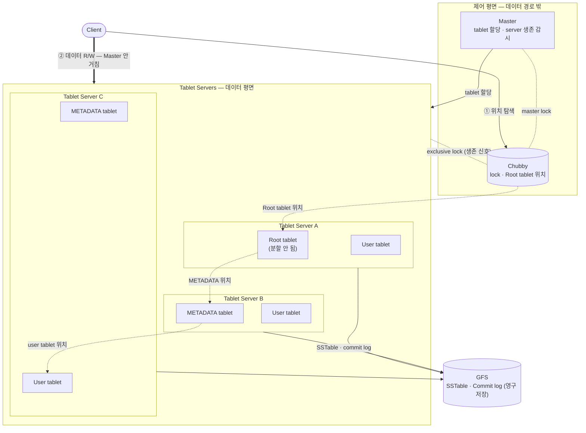

[이전 Part](/blog/bigtable2) 에서는 Bigtable 을 구성하는 핵심 Building Block — GFS, SSTable, Chubby — 을 살펴보았다.
이번 Part 에서는 실제 Implementation 에 해당하는 내용들을 정리한다: **Tablet 이 어디에 있는지 찾는 방법**, **어떻게 서버에 할당되는지**, 그리고 **실제 읽기/쓰기가 어떻게 동작하는지**.

세부로 들어가기 전에, 등장인물들이 어떻게 엮여 있는지 전체 그림을 한 장으로 보자. **데이터는 여러 Tablet server 에 흩어져 있고**, 그 위치·할당·생존 관리는 Master 와 Chubby 가, 영구 저장은 GFS 가 맡는다.



핵심은 세 가지다. (1) **위치 탐색은 3단계 체인** — Chubby 가 Root tablet 위치를 알려주고, Root tablet 이 METADATA tablet 을, METADATA 가 실제 user tablet 의 위치를 가리킨다 (점선 경로). 여기서 중요한 점 — **Root·METADATA tablet 도 결국 그냥 tablet** 이라, Master 가 일반 user tablet 과 똑같이 각각 독립적으로 서버에 할당한다. METADATA tablet 은 **여러 서버에 분산**되고(B·C), Root tablet 의 유일한 특별함은 "절대 분할되지 않는다"는 것뿐이다. 그래서 탐색 체인이 서버를 넘나든다(A → B → C). (2) **데이터 읽기/쓰기는 Client ↔ Tablet server 직접 경로**(굵은 화살표)라서 Master 를 거치지 않는다. (3) **Chubby 가 모든 상태의 중심축**이다 — Root tablet 위치도, 각 Tablet server 의 생존(lock)도, Master 끼리의 단일성 보장(master lock)도 전부 Chubby 에 모인다. 아래 세 절은 이 그림의 각 부분을 확대한 것이다.

> **잠깐 — 이 그림, 어디서 본 것 같지 않은가?**
>
> 일을 **결정**하는 컨트롤 플레인(Master + Chubby)과 실제 트래픽을 **처리**하는 데이터 평면(Tablet servers + GFS)이 갈려 있고, 그 사이를 합의 기반 코디네이션 서비스가 떠받치는 구조. 그렇다 — **Kubernetes 가 떠오른다는 사람이 꽤 있을 것이다.** 그리고 그건 우연이 아니다.

용어를 거의 1:1 로 매핑할 수 있다:

| Bigtable | Kubernetes | 역할 |
|----------|------------|------|
| Chubby | etcd | 합의 기반 메타데이터·락 저장소. 멤버십/리더 선출의 source of truth |
| Master | scheduler + controller-manager | 배치 결정(tablet 할당 ↔ pod 스케줄링)과 장애 시 재할당 |
| Tablet server | kubelet (node) | 실제 일을 하는 데이터 평면 일꾼 |
| GFS | PV / 스토리지 계층 | 영구 저장 |

관통하는 설계 원칙은 두 가지다.

**① 데이터 경로는 컨트롤 플레인을 우회한다.** Bigtable 에서 Master 가 죽어도 read/write 가 계속되듯, k8s 도 API server·scheduler 가 다 내려가도 **이미 떠 있는 Pod 는 멀쩡히 트래픽을 받는다.** 멈추는 건 "새 배치와 재배치"뿐이다. 코디네이터를 hot path 에서 빼야, 그게 병목이 되거나 잠깐 죽어도 서비스가 죽지 않는다.

**② 오케스트레이터와 합의 저장소를 분리한다.** Master 자신은 Paxos 를 돌리지 않는다. 상태의 진실은 Chubby 에 있고, Master 는 그걸 읽어 일하는 거의 stateless 한 존재라 죽으면 Chubby lock 잡고 재시작해 복구하면 그만이다. k8s 의 API server ↔ etcd 관계와 똑같다.

그리고 닮은 게 우연이 아닌 **결정적 이유** — Kubernetes 는 구글 내부 클러스터 매니저 **Borg** 의 오픈소스 후손이고, **그 Borg 도 Chubby 를 썼다.** Bigtable(2006)과 Kubernetes(2014)는 10년 가까이 떨어져 있지만, 결국 같은 구글 인프라 DNA — *합의 기반 코디네이션 + 컨트롤/데이터 평면 분리* — 에서 자란 셈이다. HDFS(NameNode/DataNode)나 Kafka(controller/broker + ZooKeeper·KRaft)도 같은 패턴을 공유한다.

---

## 1. Tablet Location — "이 데이터가 어느 서버에 있는가?"

분산 시스템에서 가장 기본적인 질문은 "내가 원하는 데이터가 어느 서버에 있는가?" 이다. 중앙 서버 하나가 모든 위치 정보를 갖고 있으면 간단하겠지만, 그러면 그 서버가 병목이 된다.

Bigtable 은 이를 **3단계 계층 구조(3-level hierarchy)** 로 해결한다. B+-tree 와 유사한 구조다.

```
[Chubby file]
      │  Root tablet 의 위치만 저장
      ▼
[Root Tablet]  ← METADATA table 의 첫 번째 tablet. 절대 분할되지 않음.
      │  나머지 METADATA tablet 들의 위치 저장
      ▼
[METADATA Tablets]
      │  실제 user tablet 들의 위치 저장 (tablet 당 ~1KB row)
      ▼
[User Tablets]  ← 실제 데이터
```

- **Chubby file**: Root tablet 이 어느 서버에 있는지만 알고 있다.
- **Root tablet**: METADATA table 의 첫 번째 tablet 이자, 다른 METADATA tablet 들의 위치 정보를 담고 있다. **절대 분할되지 않는다** — 트리의 깊이(depth) 를 고정하기 위해서다. 깊이가 달라지면 탐색 로직이 복잡해진다.
- **METADATA tablets**: 각 user tablet 의 위치를 tablet 당 약 1KB 크기의 row 에 저장한다.
- **User tablets**: 실제 데이터가 있는 곳.

METADATA tablet 하나가 최대 128MB 이므로, 이론적으로 **최대 2^34 개의 tablet** 을 저장할 수 있다.

```
128MB / 1KB per entry = 2^17 entries per METADATA tablet
2^17 METADATA tablets × 2^17 entries = 2^34 user tablets
```

한 가지 중요한 점 — **Client library 가 이 위치 정보를 캐싱한다.** 캐시가 없거나 stale 하면, Chubby → Root tablet → METADATA tablet 을 순서대로 거쳐야 하므로 최대 **3번의 network round-trip** 이 발생한다. 캐시가 살아있으면 바로 해당 Tablet server 로 간다.

---

## 2. Tablet Assignment — 누가 어느 Tablet 을 담당하는가

Tablet 하나는 동시에 **단 하나의 Tablet server** 에만 할당된다. 이 할당을 관리하는 것이 **Master** 다.

동작 방식:

1. **Tablet server 시작 시**, Chubby 의 특정 디렉토리에 **exclusive lock** 을 생성한다. 이 lock 이 곧 "나 살아있음" 신호다.
2. **Master 는 이 디렉토리를 주기적으로 스캔**하여 살아있는 Tablet server 목록을 파악한다.
3. Tablet server 가 lock 을 잃으면 (네트워크 단절, 프로세스 죽음 등) → **스스로 종료**한다.
4. Master 가 특정 Tablet server 의 lock 을 확인할 수 없으면 → 해당 server 의 tablet 들을 **다른 server 에 재할당**한다.

**Master 자체가 죽으면?**

Master 가 재시작되면 다음 순서로 상태를 복원한다:
1. Chubby 에서 Master lock 을 획득 (다른 Master 가 없음을 보장)
2. 살아있는 Tablet server 들을 스캔
3. METADATA table 을 읽어서 현재 tablet 할당 상태 복원

| ⁉️잠깐: **"Master 가 single point of failure 아닌가?"**
Bigtable 의 Master 는 tablet **할당을 관리**하지만, **실제 데이터 읽기/쓰기는 Master 를 거치지 않는다.** Client 가 Tablet server 와 직접 통신하기 때문에, Master 가 일시적으로 죽어도 서비스는 계속된다. 단, 그 사이에 tablet 재할당(fault recovery, load balancing 등)은 멈추게 된다.

---

## 3. Tablet Serving — 실제로 읽고 쓰는 방법

각 Tablet server 에서 tablet 하나가 실제로 어떤 상태로 존재하는지를 이해하면, 읽기/쓰기 흐름이 보인다.

Tablet 의 상태는 두 곳에 나뉘어 있다:

| 위치 | 내용 |
|------|------|
| GFS (영구 저장) | SSTable 파일들 + Commit log |
| Tablet server 메모리 | Memtable (최근 write 를 담은 정렬된 버퍼) |

### Write 흐름

```
Client Write
    │
    ▼
Commit Log (GFS 에 sequential append) ← redo log. 장애 복구용.
    │
    ▼
Memtable (in-memory 정렬 버퍼에 적용)
```

쓰기 요청이 오면 **먼저 Commit log 에 기록**한다. GFS 에 sequential append 로 쓰므로 빠르다. 그 다음 **Memtable 에 적용**한다.

왜 이 순서인가? Commit log 가 먼저여야 서버가 죽어도 복구가 된다. Memtable 만 있다면 프로세스가 죽는 순간 그 사이의 write 는 날아간다.

### Read 흐름

```
Client Read
    │
    ▼
Memtable + SSTable 파일들을 병합(merge)하여 응답
```

읽기는 **Memtable 과 여러 SSTable 을 병합한 view** 에서 수행된다. Memtable 과 각 SSTable 이 모두 key 기준으로 정렬되어 있기 때문에, merge 가 효율적으로 이루어진다.

여기서 "SSTable 이 여러 개 있다" 는 점이 포인트다. 시간이 지나면서 SSTable 이 쌓이는데, 개수가 늘어날수록 read 시 병합해야 할 파일도 많아진다. 이 문제를 해결하는 것이 **Compaction** 이고, 다음 Part 에서 자세히 다룬다.

---

## 정리

이번 Part 의 핵심:

- **Tablet Location**: 3-level hierarchy (Chubby → Root → METADATA → User tablets) 로 tablet 위치를 추적한다. Client 가 캐싱하여 round-trip 을 줄인다.
- **Tablet Assignment**: Master 가 Chubby lock 상태를 보고 Tablet server 생존 여부를 판단, 할당을 관리한다. 실제 데이터 경로에는 Master 가 없다.
- **Tablet Serving**: Write 는 Commit log → Memtable. Read 는 Memtable + 여러 SSTable 을 병합.

세 가지를 관통하는 하나의 주제는 **Chubby 가 모든 상태 관리의 근간** 이라는 점이다. Tablet 위치 탐색도, Tablet server 생존 확인도, Master fail-over 도 전부 Chubby 에 기댄다. Part 2 에서 Chubby 를 별도로 소개한 이유가 여기에 있었다.

다음 Part 에서는 **Compaction 3종 세트** (Minor / Merging / Major) 와 고성능을 위해 논문이 추가로 기술한 **Refinements** — Bloom filter, Locality group, Caching 등 — 을 정리해보겠다.

## References
- [Bigtable: A Distributed Storage System for Structured Data](https://static.googleusercontent.com/media/research.google.com/ko//archive/bigtable-osdi06.pdf)
