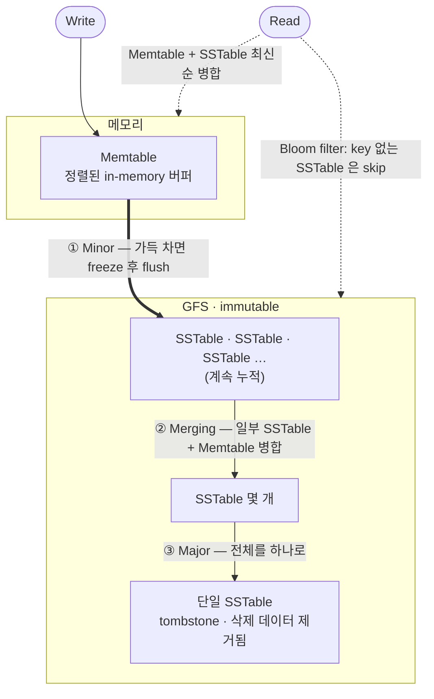

[이전 Part](/blog/bigtable3) 에서는 Tablet 의 위치 탐색, 할당, 그리고 실제 읽기/쓰기 흐름을 살펴봤다.
마지막에 이런 의문을 남겼다: **SSTable 이 시간이 지날수록 계속 쌓이면, 읽을 때 병합해야 할 파일이 너무 많아지지 않는가?**

이번 Part 에서는 이 문제를 해결하는 **Compaction** 과, Bigtable 이 실전 성능을 내기 위해 추가로 적용한 **Refinements** 들을 정리한다.

---

## 1. Compaction — SSTable 파일을 어떻게 관리하는가

Write 가 들어오면 Memtable 에 쌓인다. Memtable 이 가득 차면 SSTable 로 내려간다. 이 과정이 반복되면 SSTable 파일이 계속 늘어난다. Compaction 은 이 파일들을 주기적으로 합치고 정리하는 작업이다.

### Minor Compaction

**언제**: Memtable 이 특정 크기에 도달했을 때.

```
Memtable (가득 참)
    │
    ▼  freeze
Frozen Memtable ──→ 새 SSTable (GFS 에 저장)
    
새 Memtable 생성 (write 계속 받음)
```

Memtable 을 SSTable 로 변환하여 GFS 에 저장하고, 새 Memtable 을 만들어 write 를 계속 받는다. 두 가지 목적이 있다.

1. **메모리 확보**: 가득 찬 Memtable 을 디스크로 내보낸다.
2. **Commit log 복구 범위 축소**: SSTable 로 내려간 데이터는 장애 시 commit log 에서 다시 재생(replay) 할 필요가 없다.

Minor compaction 은 자주 일어나고 가볍다. 하지만 SSTable 파일 자체의 개수는 계속 늘어난다.

### Merging Compaction

**언제**: SSTable 파일이 일정 개수 이상 쌓였을 때, 주기적으로.

일부 SSTable 파일들과 현재 Memtable 을 읽어 **새 SSTable 하나로 병합**한다. 파일 개수를 줄여서 이후 read 시 병합해야 할 파일 수를 관리한다.

### Major Compaction

**언제**: 주기적으로 (비용이 크므로 자주 하지 않음).

**모든 SSTable → 하나의 SSTable.**

여기서 중요한 개념이 등장한다 — **Tombstone.**

> Bigtable 에서 delete 는 데이터를 즉시 지우지 않는다.

"이 key 는 삭제됨" 이라는 마커(tombstone) 를 새로 write 할 뿐이다. Minor/Merging compaction 을 할 때는 이 tombstone 이 그대로 남는다. 삭제된 데이터가 실제로 제거되는 것은 **Major compaction 때** 뿐이다.

왜 이렇게 하는가? SSTable 은 immutable 이다. 이미 GFS 에 쓰인 파일을 수정하는 대신, 새 파일에 "삭제됐음" 을 기록하는 방식이 훨씬 단순하다. 대신 공간 낭비가 생기므로, Major compaction 이 주기적으로 실제 삭제를 수행한다.

| ⁉️잠깐: **"그럼 tombstone 이 쌓이는 동안 삭제된 데이터도 계속 읽히는 거야?"**
읽기 시엔 SSTable 과 Memtable 을 최신 순서로 병합하므로, tombstone 이 있는 key 는 "삭제됨" 으로 처리되어 응답에 포함되지 않는다. 실제 물리적 삭제는 나중에 일어나지만, **논리적으로는 즉시 삭제된 것처럼 동작**한다.

### 전체 생애주기 한눈에

세 종류의 compaction 을 따로 보면 헷갈리지만, 데이터가 메모리에서 디스크로 흘러내려가며 **점점 적은 수의 SSTable 로 수렴**한다는 하나의 흐름으로 보면 명확해진다.



Write 는 항상 메모리(Memtable)로만 들어가고, 디스크의 SSTable 은 한 번 쓰이면 불변이다. 그래서 "수정"이 없고 오직 **새 파일 추가 + 주기적 병합**만 있다. Read 는 그 시점의 Memtable 과 모든 SSTable 을 가로질러 병합하되, Bloom filter 로 불필요한 파일을 쳐낸다.

> **잠깐 — 이 흐름, 어디서 본 것 같지 않은가?**
>
> 메모리의 정렬 버퍼에 쓰고 → 차면 immutable 파일로 flush 하고 → 파일이 쌓이면 백그라운드에서 병합하고 → 읽을 땐 여러 파일을 merge 하며 Bloom filter 로 가지치기한다. 이 패턴엔 이름이 있다 — **LSM-tree (Log-Structured Merge-tree).**

그리고 핵심은, **네가 실무에서 쓰는 store 들이 대부분 이거다.**

| 시스템 | 비고 |
|--------|------|
| LevelDB | Bigtable 저자(Jeff Dean · Sanjay Ghemawat)가 만든 단일 노드 LSM 엔진 |
| RocksDB | LevelDB 를 Facebook 이 포크·확장 |
| Cassandra · ScyllaDB | Memtable · SSTable · Compaction 용어를 그대로 사용 |
| HBase | Bigtable 의 오픈소스 클론. HDFS 위에서 동일한 구조 |

Memtable, SSTable, tombstone, compaction, bloom filter — 이 글에서 본 단어들이 저 시스템들의 문서에 거의 그대로 등장한다. Bigtable 논문(2006)이 사실상 LSM-tree 를 산업 표준으로 끌어올린 셈이다.

---

## 2. Refinements — 구글이 실전에서 추가한 것들

기본 구조만으로 대규모 트래픽을 감당할 수는 없다. 논문의 Refinements 섹션은 Bigtable 이 실전에서 성능을 내기 위해 어떤 선택을 했는지를 담고 있다. 설계 철학을 읽는 느낌이 있는 파트다.

### Locality Groups

Column family 들을 **Locality group** 으로 묶을 수 있다. Locality group 마다 별도의 SSTable 이 생성된다.

```
column family: "anchor", "links"  →  locality group A  →  SSTable_A
column family: "contents"         →  locality group B  →  SSTable_B
```

왜 유용한가? 예를 들어, 어떤 query 는 `anchor` 와 `links` 는 자주 읽지만 `contents` (HTML 전체) 는 거의 안 읽는다. 이때 한 SSTable 에 다 섞여있으면 불필요한 데이터까지 디스크에서 읽어야 한다. Locality group 으로 분리하면 필요한 것만 읽는다.

더 나아가, **특정 locality group 은 아예 메모리에 올려둘 수도 있다.** METADATA table 의 위치 정보처럼 자주 접근하는 소용량 데이터에 유용하다.

### Compression

Locality group 단위로 압축을 적용할 수 있다. 두 단계 압축을 사용한다.

1. **Bentley-McIlroy scheme**: 큰 윈도우에서 반복 패턴 압축. 압축률이 높다.
2. **Zippy (Snappy 의 전신)**: 빠른 압축. 압축률보다 속도를 우선.

같은 column family 끼리 모여있으면 데이터 패턴이 유사하므로 압축률이 높다. 논문에 따르면 Webtable 에서 HTML 콘텐츠의 경우 10:1 까지 나왔다고 한다. 전체적으로는 2:1 ~ 10:1.

### Caching — 두 단계 캐시

**Block Cache**: SSTable 의 블록(64KB 단위) 자체를 캐시한다. 최근 읽은 블록 근처를 다시 읽을 때 (spatial locality) 유리하다.

**Scan Cache**: key-value 쌍 자체를 캐시한다. 동일한 데이터를 반복해서 읽는 패턴에 유리하다.

두 캐시의 계층이 다르다는 점이 포인트다. Block Cache 는 raw 블록 단위, Scan Cache 는 파싱된 key-value 단위. Scan Cache 히트 시 더 빠르지만, 적중하지 않으면 Block Cache 를 확인한다.

### Bloom Filters

> "이 SSTable 에 이 key 가 있는가?"

SSTable 마다 **Bloom filter** 를 만들어둔다. Bloom filter 는 probabilistic 자료구조로, "없다" 는 확실히 알 수 있고 "있다" 는 높은 확률로 알 수 있다 (false positive 는 있어도, false negative 는 없다).

```
Read 요청 for key K
    │
    ▼
Bloom filter 확인 (O(1))
    │
    ├── "없음" → 이 SSTable 디스크 read 생략 ← 핵심
    └── "있을 수 있음" → 실제 디스크 read
```

SSTable 이 여러 개 쌓여있는 상황에서, Bloom filter 덕분에 실제로 해당 key 가 없는 SSTable 의 디스크 read 를 건너뛸 수 있다. 논문에 따르면 이 최적화가 없으면 대부분의 read 에서 불필요한 디스크 접근이 발생한다고 한다.

### Commit Log 최적화

**문제**: Tablet server 하나가 여러 tablet 을 담당한다. 각 tablet 마다 별도의 commit log 파일을 GFS 에 쓰면, 동시에 너무 많은 파일을 write 해야 한다. GFS 에서 동시 write 가 많으면 seek time 이 늘어난다.

**해결**: 모든 tablet 의 write 를 **하나의 commit log 파일에 섞어서** 쓴다.

**새로운 문제**: Tablet 이 다른 서버로 재할당될 때, 새 서버는 자기가 담당할 tablet 의 log 만 읽어야 하는데, 하나의 파일에 여러 tablet 의 log 가 섞여있다.

**해결**: Log entry 를 `(table, row, log sequence number)` 기준으로 정렬한다. 그러면 한 tablet(연속된 row 범위)의 mutation 들이 파일 안에서 연속 배치되어, 한 번의 seek + sequential read 로 읽을 수 있다. 정렬 자체는 commit log 파일을 **64MB segment 단위로 쪼개어** 여러 tablet server 가 병렬로 수행하며, 이 과정은 Master 가 조율한다.

### Immutability 활용

마지막으로, SSTable 이 **immutable** 이라는 특성을 적극적으로 활용한다.

- SSTable 은 한 번 GFS 에 쓰이면 변경되지 않는다.
- 따라서 **여러 reader 가 lock 없이 동시에 읽을 수 있다.**
- Mutable 한 것은 Memtable 뿐. Memtable 은 row 단위 copy-on-write 으로 동시 read/write 를 지원한다.
- 오래된 SSTable 을 제거할 때는 mark-and-sweep 방식을 사용한다 (파일을 직접 삭제하는 대신, 참조되지 않는 파일을 주기적으로 GC).

Immutability 는 단순한 설계 원칙이 아니라, 동시성 제어 비용을 근본적으로 낮추는 전략이다.

---

## 정리 — 그래서 Bigtable 을 어떻게 이해할 것인가

4개의 Part 를 통해 Bigtable 전체를 훑었다. 전체 그림을 하나로 연결해보면:

```
[Write]
Client → Commit log (GFS, sequential) → Memtable (in-memory, sorted)
                                              │ (가득 차면)
                                              ▼ Minor Compaction
                                         SSTable (GFS, immutable)
                                              │ (파일 많아지면)
                                              ▼ Merging / Major Compaction
                                         SSTable 병합 (tombstone 정리 포함)

[Read]
Client → Tablet Location (3-level hierarchy, cached)
       → Tablet server
       → Bloom filter 확인 → 불필요한 SSTable skip
       → Memtable + SSTable 병합 → 응답
```

Bigtable 이 인상적인 이유는 단순한 아이디어들을 잘 조합했다는 점이다.

- **GFS** 로 영구 저장 문제를 해결하고,
- **SSTable + Memtable** 로 write 성능을 확보하고,
- **Chubby** 로 분산 코디네이션을 위임하고,
- **Compaction** 으로 파일 수 증가 문제를 관리하고,
- **Bloom filter, Locality group, Caching** 으로 read 성능을 보완한다.

"이미 구글에서 만든 것들을 잘 엮었다" 는 표현이 Part 2 마지막에 있었는데, 그 감상이 Refinements 를 보고 나면 더 명확해진다. 각 Refinement 가 독립적이고, 어떤 것을 적용할지 per-locality-group 으로 선택할 수 있다. 설계가 조합 가능하게 되어있다는 것이 핵심이다.

다음은 이 시리즈에서 자주 언급된 **LevelDB** — Bigtable 의 아이디어를 단일 노드에 최적화한 버전 — 를 정리해볼 생각이다. Bloom filter, SSTable, Compaction 개념이 LevelDB 에서 어떻게 구체화되는지 보면 Bigtable 이 더 잘 이해된다.

## References
- [Bigtable: A Distributed Storage System for Structured Data](https://static.googleusercontent.com/media/research.google.com/ko//archive/bigtable-osdi06.pdf)
- [The Chubby lock service for loosely-coupled distributed systems](https://research.google/pubs/the-chubby-lock-service-for-loosely-coupled-distributed-systems/)
